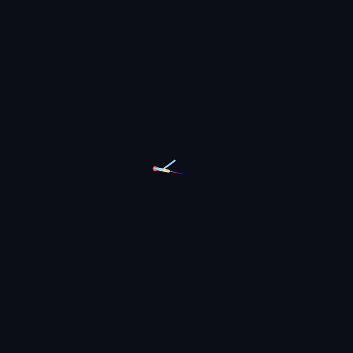

# 🪰 The World's First Drawing Drawn by a Fly

A fruit fly's entire brain has been mapped and digitized: 139,255 neurons and every connection between them. Recently it escaped the lab and went viral. The digital fly walked, groomed itself, even played DOOM.

I downloaded that map, built a neural network from its real wiring, and set a digital fly loose in 3D space.

It flies, and behind it hangs a glowing trail. That is how it draws: not with a brush, but with its own flight. Every turn, every dive and every loop is decided by wiring copied from a living brain.

What you see is the path it left in the dark.

Code: `fly_draw_3d.py` · Data: [FlyWire connectome](https://codex.flywire.ai)
